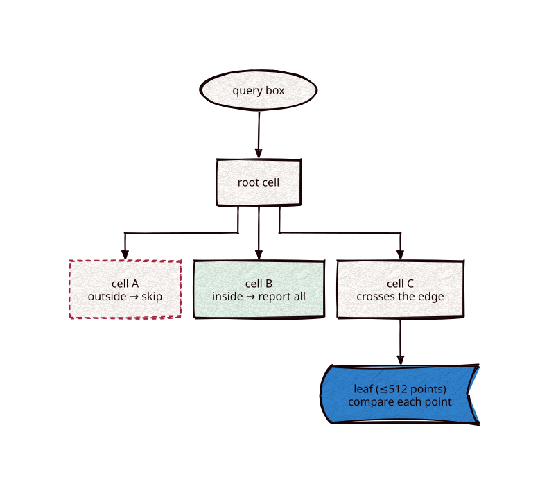

# bkd

[](https://github.com/Kronuz/bkd/actions/workflows/ci.yml)
[](LICENSE)


Block KD trees over points of 1 to 8 dimensions of `uint64_t` keys, for C++20.
Header-only, no dependencies. It is the points index under range filters that touch many
documents: numeric and date ranges (1-D), interval intersection (2-D over start and end),
and geo (the dimensions a geo index keeps).



## ✨ Highlights

One header, `bkd.hh`:

- `tree<D>::build(points, leaf_size)` splits the points at the median of the widest
  dimension until a cell holds at most `leaf_size` (512 by default, a preset). Every node
  keeps its cell's bounding box.
- `query(box, emit)` reports each point inside an inclusive box. Cells outside the box
  are skipped and cells inside it are reported whole, without comparing their points;
  only cells crossing the box's edge compare points.
- `count(box)` counts the same points, adding whole cells from their sizes.
- Build and query use explicit stacks, so depth never grows the native stack.

Interval intersection: a document interval `[a, b]` meets a query `[c, d]` when
`a <= d` and `b >= c`, the 2-D box `{[0, d], [c, max]}` over `(start, end)`.

## 📦 Installation

Requires a C++20 compiler; CMake 3.14 or newer for the CMake route. CI builds it on
Linux (x86_64, arm64), macOS (arm64, x86_64), and FreeBSD, plus ASan, UBSan, and TSan
builds.

```cmake
include(FetchContent)
FetchContent_Declare(bkd
  GIT_REPOSITORY https://github.com/Kronuz/bkd.git
  GIT_TAG        main)
FetchContent_MakeAvailable(bkd)

target_link_libraries(my_app PRIVATE bkd::bkd)
```

## 🚀 Quick start

```cpp
#include "bkd.hh"

std::vector<bkd::point<2>> points = {{{10, 20}, 0}, {{15, 25}, 1}};
auto tree = bkd::tree<2>::build(std::move(points));
bkd::box<2> box{{0, 12}, {14, ~0ull}};       // intervals meeting [12, 14]
tree.query(box, [](std::uint32_t ordinal) { /* ... */ });
```

## 🚧 Status

In memory. The on-disk layout (packed preorder nodes, per-tree dimension counts, index
and data dimensions) follows strata's Phase 4 design once its geo measurement settles
which dimension counts are kept.

## 🎯 When to use it

- ✅ Numeric, date, interval, and geo range filters over many documents.
- ❌ Updates: build once from all points; it is in-memory for now.

## 📚 Documentation

- [AGENTS.md](AGENTS.md): repository map and invariants.

## 🤝 Contributing

Issues and pull requests are welcome. Read [AGENTS.md](AGENTS.md) first. CI must
pass on every platform.

## 📄 License

MIT, Copyright (c) 2026 Germán Méndez Bravo. See [LICENSE](LICENSE).
