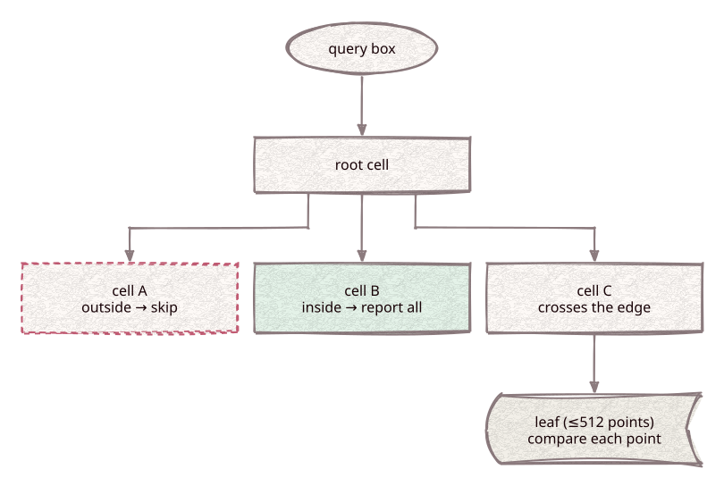

# bkd

Part of [Kronuz C++ Libraries](https://github.com/Kronuz/cpp-libraries), a collection of small, reusable C++ libraries.

[](https://github.com/Kronuz/bkd/actions/workflows/ci.yml)
[](LICENSE)


Header-only block KD tree for C++20: box queries over 1-8 dimensional uint64_t points that
take inside cells whole. Every node keeps its cell's bounding box, so a query skips cells
outside the box, reports cells inside it without reading their points, and compares points
only in leaves that cross the box's edge. Reach for it as the points index under range
filters that touch many documents: numeric and date ranges (1-D), interval intersection
(2-D) and geo.



## ✨ Highlights

- **`tree<D>::build(points, leaf_size)`** splits the points at the median of the widest
  dimension until a cell holds at most `leaf_size` points (512 by default).
- **`query(box, emit)`** calls `emit(ordinal)` once for each point inside an inclusive
  box.
- **`count(box)`** counts the same points, adding inside cells from their sizes.
- **Interval intersection:** a document interval `[a, b]` meets a query `[c, d]` when
  `a <= d` and `b >= c`, the 2-D box `{[0, d], [c, max]}` over `(start, end)`.
- **No recursion:** build and query keep explicit stacks, so depth never grows the
  native stack.
- **Checked against brute force** in 1, 2, 3 and 8 dimensions with leaf sizes 1 to 512,
  and by a libFuzzer target.

## 🚀 Quick start

```cpp
#include "bkd.hh"

#include <cstdint>
#include <cstdio>
#include <vector>

int main() {
	// Intervals as 2-D points (start, end), each with a document ordinal.
	std::vector<bkd::point<2>> points = {{{10, 20}, 0}, {{15, 25}, 1}, {{30, 40}, 2}};
	auto tree = bkd::tree<2>::build(std::move(points));

	bkd::box<2> meets{{0, 12}, {14, ~0ull}};  // start <= 14 and end >= 12: meets [12, 14]
	tree.query(meets, [](std::uint32_t ordinal) { std::printf("doc %u\n", ordinal); });  // doc 0
	std::printf("%zu\n", tree.count(meets));  // 1
}
```

## 📦 Installation

Requires C++20 and CMake 3.14 or newer; no other dependencies. CI builds and tests it on
Linux (x86_64 with GCC and Clang, arm64), macOS (arm64, x86_64) and FreeBSD, plus ASan,
UBSan and TSan builds.

```cmake
include(FetchContent)
FetchContent_Declare(bkd
  GIT_REPOSITORY https://github.com/Kronuz/bkd.git
  GIT_TAG        4ddc2cf09d3fc9fbc7f1d7a81da20f238e3b419d)  # or main, to track the tip
FetchContent_MakeAvailable(bkd)

target_link_libraries(my_app PRIVATE bkd::bkd)
```

Link `bkd::bkd` and include `bkd.hh`.

## 🎯 When to use it

- Numeric, date, interval and geo range filters over many documents, where whole cells
  inside the range are the common case.

Not for:

- Updates: a tree is built once from all its points and does not change.
- Persistence: the tree lives in memory and has no on-disk format.
- Signed or floating-point keys as they are: keys are `uint64_t`, so map them to an
  order-preserving unsigned encoding first.
- More than 8 dimensions, or more than 2^32 points: `D` is 1 to 8 and ordinals are
  `uint32_t`.

## 📚 Documentation

- [AGENTS.md](AGENTS.md): repository map, invariants and how to verify a change.
- [Catalog entry](https://github.com/Kronuz/cpp-libraries/blob/main/AGENTS.md#bkd) in
  Kronuz C++ Libraries.

## 🛠️ Building and testing

```sh
cmake -B build -DCMAKE_BUILD_TYPE=Release
cmake --build build
ctest --test-dir build --output-on-failure
```

`-DBKD_FUZZ=ON` adds the libFuzzer target, which needs a Clang with libFuzzer.

## 🤝 Contributing

Issues and pull requests are welcome; read [AGENTS.md](AGENTS.md) and the catalog's
[rules of engagement](https://github.com/Kronuz/cpp-libraries/blob/main/AGENTS.md#rules-of-engagement)
first.

## 📄 License

MIT, see [LICENSE](LICENSE).
